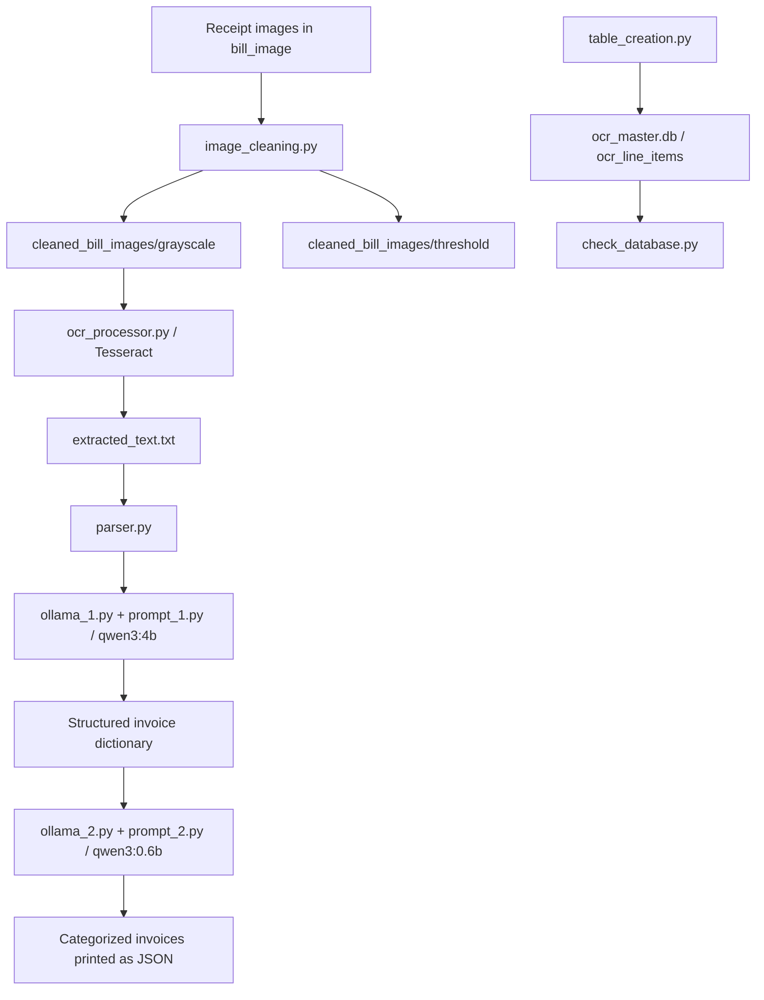

# Chat With Your Bills

> **Rebuild in progress.** The project is being rebuilt following [docs/IMPLEMENTATION_PLAN.md](docs/IMPLEMENTATION_PLAN.md). Phases 0–6 are done: photo → RapidOCR → qwen3:4b → checks → (VLM re-read when needed) → SQLite, with a FastAPI backend and a browser app. Phase reports are in [reports/](reports/README.md). The original prototype described below now lives in `legacy/` (example images in `samples/`), and the evaluation tools are in `eval/`.
>
> **Run the server** (Ollama must be running; on a laptop, keep the charger plugged in), then open http://127.0.0.1:8000 for the app (http://127.0.0.1:8000/docs for the API):
> ```powershell
> .\.venv\Scripts\python.exe -m uvicorn app.main:app --host 127.0.0.1 --port 8000
> ```
>
> Setup and command-line tools:
>
> ```powershell
> python -m venv .venv
> .\.venv\Scripts\python.exe -m pip install -r requirements.txt
> ollama pull qwen3:4b                                                 # Ollama must be running
> .\.venv\Scripts\python.exe -m app.cli process samples                # full pipeline -> JSON
> .\.venv\Scripts\python.exe -m app.cli process samples --save         # ... and store in data\bills.db
> .\.venv\Scripts\python.exe -m app.cli list                           # stored receipts (filters: --status, --category, --from, --to, --search)
> .\.venv\Scripts\python.exe -m app.cli show 1                         # one receipt with items, warnings, notes
> .\.venv\Scripts\python.exe -m app.cli export --out backup.json       # everything as JSON
> .\.venv\Scripts\python.exe -m app.cli ocr samples\receipt_2.jpeg     # OCR only
> .\.venv\Scripts\python.exe -m pytest                                 # unit tests
> .\.venv\Scripts\python.exe -m eval.run_eval --help                   # score against eval/ground_truth
> ```
>
> The rest of this README describes the original prototype; its commands must now be run from inside `legacy/`, and its scripts still expect images in `bill_image/`. It will be rewritten in Phase 9.

## Overview

This project is a Python command-line prototype that converts receipt images into structured, categorized invoice data. It uses OpenCV for image preprocessing, Tesseract for optical character recognition (OCR), and two local Ollama models for invoice extraction and expense classification.

The current implementation prints the final data as JSON. It does **not** yet provide a chat interface, web application, bill-querying workflow, or automatic database persistence. SQLite table creation and inspection are separate utilities.

## Architecture and data flow



There is currently no connection between the parser's output and the database utilities. The two model stages are called “Agent 1” and “Agent 2” in source comments; they are synchronous Python wrappers around the Ollama CLI.

## File guide

| File or directory | Responsibility |
| --- | --- |
| `bill_image/` | Source receipt images; three JPEG examples are present. |
| `image_cleaning.py` | Produces enhanced grayscale and adaptive-threshold versions of each source image. |
| `cleaned_bill_images/grayscale/` | Current OCR input directory. |
| `cleaned_bill_images/threshold/` | Alternative preprocessing output, not consumed by the default OCR configuration. |
| `cleaned_bill_images/*.jpeg` | Additional images at the directory root; the current pipeline does not read these. |
| `ocr_processor.py` | Runs Tesseract on grayscale images and overwrites the combined OCR text file. |
| `ocr_processor_test.py` | Manual comparison of Tesseract page segmentation modes 4, 6, and 11. |
| `extracted_text.txt` | Intermediate text containing filename-marked receipt sections. |
| `prompt_1.py` | Builds the conservative invoice-extraction prompt and defines the requested fields. |
| `ollama_1.py` | Calls `qwen3:4b`, extracts a JSON object from the response, and parses it. |
| `prompt_2.py` | Defines expense categories and builds the classification prompt. |
| `ollama_2.py` | Calls `qwen3:0.6b`, cleans the response, and selects a category. |
| `parser.py` | Reads OCR sections, extracts invoice fields, categorizes each line item, and prints results. |
| `table_creation.py` | Creates the SQLite line-item table if absent. |
| `check_database.py` | Prints SQLite table names and line-item column metadata. |
| `ocr_master.db` | Existing SQLite database file. |
| `__pycache__/` | Generated Python bytecode cache. |

## Processing stages

### 1. Image preprocessing

`image_cleaning(input_folder, grayscale_folder, threshold_folder)` accepts `.jpg`, `.jpeg`, and `.png` files, with case-insensitive extension matching. For each readable image, it:

1. Converts BGR color to grayscale.
2. Enlarges the image by 2× using cubic interpolation.
3. Applies CLAHE contrast enhancement with a clip limit of 2.0 and an 8×8 tile grid.
4. Applies a median filter with kernel size 3.
5. Generates an adaptive Gaussian threshold image with block size 31 and constant 10.
6. Saves both the enhanced grayscale and threshold images under the original filename.

The script creates its output directories at module import. Unreadable images are skipped, and per-image exceptions are printed.

### 2. OCR

`perform_ocr(input_folder, output_file)` reads `cleaned_bill_images/grayscale` and calls `pytesseract.image_to_string(..., config="--psm 4")`. Source comments identify grayscale and PSM 4 as the preferred settings from earlier manual comparisons; no accuracy benchmark is included.

Each receipt is written using this format:

```text
-- Text from receipt_1.jpeg --
OCR text for this receipt
```

The complete output overwrites `extracted_text.txt`. A missing input folder causes an early return. Individual OCR failures are logged and processing continues; an existing folder with no successful results can produce an empty output file.

### 3. Invoice extraction

`parser.parse_multiple_invoices()` splits the text on `-- Text from ` and passes each receipt's text to `ollama_1.get_json_from_prompt()`.

The extraction wrapper sends the prompt through standard input to `ollama run qwen3:4b`. Its response parser removes Markdown fences and finds the first balanced JSON object, accounting for quoted strings and escapes. It then decodes JSON and checks that the result is a dictionary.

The prompt requests only explicitly present information, uses `"Unknown"` for uncertain fields, excludes totals/taxes and other non-item labels from descriptions, and asks for equally sized `Description` and `Amount` arrays. These are prompt instructions, **not a runtime schema validator**. The `JSON_SCHEMA` constant is a dictionary of field descriptions rather than a formal JSON Schema.

### 4. Expense classification

For every paired description and amount, the parser calls `get_category_from_ollama()` through `ollama run qwen3:0.6b`. Allowed categories are:

- Food
- Logistics
- Drinks
- Travel
- Grocery Expense
- Utilities
- Other

The prompt places rent and rental payments in Utilities. Response handling removes terminal escape sequences, some thinking-output markers, quotes, and Markdown characters. It tries exact matches, whole-line matches, and a category at the end of the response.

Blank input, empty model output, or an unrecognized category returns `Other`. Process startup, communication, or nonzero-exit failures return `Uncategorized LLM Error`, which is outside the normal category list.

### 5. Result assembly

The parser replaces the original `Description` string array with dictionaries containing `service_description`, `Amount`, and `Category`. It adds `source_file` and retains the original top-level `Amount` array.

Illustrative output shape, not a verified model result:

```json
[
  {
    "Invoice_No": "INV-001",
    "Issue_Date": "2026-09-01",
    "billed_to": "Unknown",
    "billed_by": "Example Store",
    "Description": [
      {
        "service_description": "Bottled water",
        "Amount": 20,
        "Category": "Drinks"
      }
    ],
    "Amount": [20],
    "Grand_Total": 20,
    "source_file": "receipt_1.jpeg"
  }
]
```

The function returns a list; running `parser.py` prints that list with `json.dumps(..., indent=4)` alongside progress messages. Redirecting its entire standard output therefore does not create a clean JSON document.

## Setup and execution

### Prerequisites

- Python 3.10 or newer, as required by the `str | None` annotation in the source. Dependency compatibility has not been verified across Python versions.
- Python packages `opencv-python` and `pytesseract`.
- A separate Tesseract OCR installation. Both OCR scripts currently hard-code `C:\Program Files\Tesseract-OCR\tesseract.exe`; adjust these assignments if your installation differs.
- Ollama installed, available on `PATH`, and running, with the `qwen3:4b` and `qwen3:0.6b` models available locally.

There is no dependency manifest or lockfile in the current directory. The remaining imports use Python's standard library, including `sqlite3`; the project does not use an Ollama Python SDK.

### Windows PowerShell

Run commands from the project root because all data paths resolve relative to the current working directory.

```powershell
python -m venv .venv
.\.venv\Scripts\python.exe -m pip install opencv-python pytesseract

ollama pull qwen3:4b
ollama pull qwen3:0.6b

.\.venv\Scripts\python.exe image_cleaning.py
.\.venv\Scripts\python.exe ocr_processor.py
.\.venv\Scripts\python.exe parser.py
```

Place new receipt images in `bill_image/` before preprocessing. Model downloads require network access and disk space. Model execution uses the local Ollama CLI. If the Ollama service is not running, start it before parsing.

To parse the existing OCR text without repeating image processing:

```powershell
.\.venv\Scripts\python.exe parser.py
```

Optional database setup and inspection:

```powershell
.\.venv\Scripts\python.exe table_creation.py
.\.venv\Scripts\python.exe check_database.py
```

These commands create or inspect the schema; they do not insert parsed invoices.

## Database schema

`table_creation.py` defines `ocr_line_items` in `ocr_master.db`:

| Column | SQLite type | Constraint or intended content |
| --- | --- | --- |
| `Invoice_No` | TEXT | NOT NULL; first part of the primary key. |
| `line_item_id` | INTEGER | NOT NULL; second part of the primary key. |
| `Issue_Date` | TEXT | Invoice date. |
| `billed_to` | TEXT | Customer or billed party. |
| `billed_by` | TEXT | Issuer or vendor. |
| `Description` | TEXT | Individual line-item description. |
| `Category` | TEXT | Expense category. |
| `Amount` | REAL | Individual line-item amount. |
| `Grand_Total` | REAL | Invoice total. |
| `source_file` | TEXT | Original image filename. |

The composite primary key is `(Invoice_No, line_item_id)`. The parser does not generate `line_item_id` or implement an insertion mapping. Future persistence must handle unknown invoice numbers, duplicate invoice numbers across vendors, and conversion of uncertain monetary values. Summing a repeated `Grand_Total` across line-item rows would overcount invoice totals.

Both database utilities execute at module import rather than behind a `__main__` guard. `CREATE TABLE IF NOT EXISTS` does not migrate an existing table. `check_database.py` displays schema metadata, not stored receipt rows.

## Manual checks and troubleshooting

```powershell
# Compare OCR segmentation settings; results are printed for visual review.
.\.venv\Scripts\python.exe ocr_processor_test.py

# Exercise extraction with the built-in sample invoice.
.\.venv\Scripts\python.exe ollama_1.py

# Exercise classification with the built-in rental-bill example.
.\.venv\Scripts\python.exe ollama_2.py
```

These are manual checks, not an assertion-based automated test suite.

| Symptom | What to check |
| --- | --- |
| OCR input folder or OCR text is missing | Run the preceding pipeline stage and check the working directory. |
| Tesseract cannot be started | Confirm its installation and the executable path in both OCR scripts. |
| Ollama is not found | Ensure the CLI is installed and on the current shell's `PATH`. |
| Invoice extraction fails | Read the printed error; verify model availability and the returned JSON. The parser skips failed sections and continues. |
| Parsing returns an empty list | Check that OCR text is nonempty and uses the expected filename markers; inspect extraction errors. |
| Classification returns an error label | Check the Ollama process error printed before `Uncategorized LLM Error`. |
| Database has no newly parsed data | Automatic insertion is not implemented. |

## Current limitations and extension points

- Processing is sequential: one extraction CLI invocation per receipt and one classification invocation per paired line item. There are no subprocess timeouts, retries, or caching.
- `zip(Description, Amount)` silently drops unmatched entries when array lengths differ. Types, required fields, dates, numeric amounts, and totals are not validated.
- Filename separators form an informal text format; malformed sections or filenames containing `--` can interfere with parsing.
- Directory traversal is unsorted, and preprocessing does not remove stale outputs. Removed source images can remain available to later OCR runs.
- OCR and model output can contain errors despite conservative prompting. No measured extraction or categorization accuracy is supplied.
- Configuration is embedded in individual scripts; there is no central configuration, orchestration command, or dependency lockfile.
- The current supported inputs are images, with no PDF ingestion.
- Structured results are neither saved to a JSON file nor inserted into SQLite. Chat, search, reporting, and a UI remain future work.

Natural places to extend the project are runtime validation after extraction, an explicit JSON export, a database writer that maps each enriched description to a row, and then a query/chat layer over persisted invoices. These are proposed extensions, not implemented features.

## Documentation verification

This guide was prepared by inspecting all ten Python source files and the directory layout. The database schema above comes from `table_creation.py`; existing database contents were not audited. OCR, model inference, installation commands, and the full pipeline were not executed as part of this documentation work.
# chat_with_your_bills

